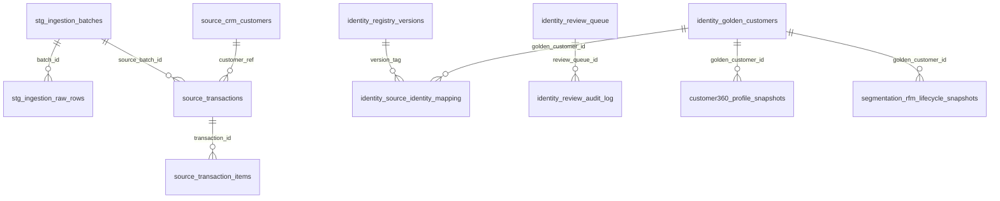

# VTEKI — Implementasi khusus Orang 3 / James

**Basis:** Snapshot `Capstone.zip` yang diberikan pada 15 Oktober 2026, bukan perubahan live di GitHub. **Jangan deploy atau push langsung ke `main` tanpa pemeriksaan CI dan database nyata.**

## 1. Apa yang dikerjakan dan apa yang tidak diubah

| Scope James | Kondisi pada ZIP | Perubahan paket ini / tahap verifikasi |
|---|---|---|
| Skema domain `core, stg, feat, ml, dec, act, msr, gov` dan Alembic | Ada migrasi 0001–0009; juga schema `source`, `identity`, `customer360`, `segmentation` | Tambah 0010 untuk validasi tipe ID customer, snapshot C360, audit append-only, indeks/checks. **Skema PostgreSQL ≠ partisi fisik**. `PARTITION BY` masih butuh kesepakatan volume/retensi dan strategi FK |
| JWT / bcrypt / RBAC server | `api/auth.py`, `api/security.py`, dan dependensi bcrypt sudah tersedia | Tidak menghapus login maupun melemahkan RBAC. Izin database dipisah dari RBAC aplikasi. Audit per-endpoint harus diuji di PostgreSQL/CI |
| Audit & trace “mengapa ini terjadi?” | `api/audit.py`, `api/audit_router.py`, `api/governance.py`, `gov.audit_event` | PostgreSQL trigger append-only untuk 2 tabel audit, indeks `(correlation_id, occurred_at, id)`. **Target ≤5 menit belum dibuktikan melalui load test** |
| APScheduler/run lock/NFR-01 | `worker/scheduler.py` memakai PostgreSQL advisory lock dan anggaran 3600 detik | Basis dipertahankan. Timeout yang dicek setelah handler selesai **tidak menghentikan handler macet**. Perlu timeout/cancellation proses terpisah, benchmark dan SLA nyata |
| CI/CD | `.github/workflows/ci.yml` sudah menjalankan Ruff, Black target tertentu, MyPy, pytest, Schemathesis, T-SEC-03, Vite build | Tambah regression test James yang dijalankan oleh `pytest`; tidak memodifikasi algoritma generator untuk menghilangkan error format lintas tim |
| Frontend React/Vite | `web/src/App.tsx` dan `web/src/api.ts` sudah memuat 6 persona/menu | Customer 360/provenance, campaign builder/approval, manual identity review, NBA/override, monitoring drift/observed/incremental/audit trace sudah ada. Paket tidak memaksa mode *skip login*; verifikasi E2E/UI dan hak akses tetap diperlukan |
| Ingestion/identity/snapshot PostgreSQL | Adapter awal dan migrasi 0009 ada | Loader typed 10 CSV atomik, registry merge seluruh cluster, C360 `rule_version`, validasi IDR/timestamps, role SQL |

**File milik tim data yang sengaja tidak dimodifikasi:** `services/data/ingestion/contracts.py`, `services/data/identity/resolver.py`, `services/data/customer360/profile.py`, `services/data/segmentation/snapshot.py`, generator synthetic dan dokumen baseline. CSV tetap diproses dengan aturan tim Data Engineering.

## 2. ERD PostgreSQL (logis)



Skema domain milik platform adalah `core`, `stg`, `feat`, `ml`, `dec`, `act`, `msr`, `gov`. Pemisahan `source`, `identity`, `customer360`, `segmentation` adalah **namespace bisnis tambahan**, bukan partisi fisik `PARTITION BY`.

## 3. Data contract dan tipe PostgreSQL

- **10 CSV Ingestion v2:** `branches`, `catalogue_items`, `crm_customers`, `transactions`, `transaction_items`, `app_events`, `service_cases`, `consent_events`, `membership_events`, `customer_visits`.
- PK sumber mengikuti ID string CSV dan harus unik; FK pada transaksi/items/visits/consent mengikuti migrasi 0009. `source_customer_id` dari CSV merupakan UUID 36 karakter. Migrasi 0010 memperlebar `VARCHAR(32)` yang tidak cukup menjadi `VARCHAR(64)` pada tujuh kolom di `source.*`.
- Uang: `source.transactions.{gross_amount,discount_amount,net_amount,refund_amount,actual_revenue}`, `source.catalogue_items.list_price`, `customer360.profile_snapshots.retained_revenue`, `segmentation.rfm_lifecycle_snapshots.{monetary,revenue_90d}` menggunakan `BIGINT` IDR. Loader mem-parsing angka bulat **tanpa float** dan adapter snapshot menolak float/fraksi.
- Timestamp input CSV harus offset-aware `+07:00`. Migrasi menggunakan PostgreSQL `TIMESTAMPTZ`; representasi instant dapat disimpan UTC, lapisan UI/API yang memformat zona Asia/Jakarta. Adapter snapshot menerima timestamp aware, menolak nilai naif.
- `identity.golden_customers`: PK `golden_customer_id`, status `PROVISIONAL`, `REVIEW_REQUIRED`, `APPROVED`, `REJECTED`; `identity.source_identity_mapping` unique sumber (`source_customer_id`) dan FK Golden ID + registry version; `match_decisions` unique batch+pair; `review_queue` unique version+pair; `review_audit_log` append-only; `registry_versions` PK version tag.
- `customer360.profile_snapshots`: unique `(golden_customer_id,cutoff_at,identity_registry_version,rule_version)` setelah 0010, default migrasi historis `c360-development-v1`. Source batch tetap kolom provenance, **bukan** anggota kunci unik.
- `segmentation.rfm_lifecycle_snapshots`: kunci unik tersebut sudah dimiliki dari migrasi 0009; tidak diubah.
- Snapshot dan registry versi lama **tidak** otomatis dimigrasikan/direkonsiliasi apabila terjadi duplicate target key; migrasi 0010 sengaja berhenti sampai konflik diselesaikan.

## 4. Index dan constraint

| Tabel | Kunci/indeks/constraint |
|---|---|
| `stg.ingestion_batches` | PK `batch_id`, indeks `status`, check status |
| `stg.ingestion_raw_rows` | PK gabungan `(batch_id, table_name, source_id)`; FK batch, indeks `(table_name,source_id)` |
| `source.crm_customers` | PK `crm_customer_id`, FK cabang, indeks email/phone/member_code |
| `source.transactions` | PK `source_transaction_id`; FK customer/branch/batch; indeks customer/datetime |
| `identity.source_identity_mapping` | PK source ID, FK Golden ID/registry version; indeks Golden ID |
| `identity.match_decisions` | Unique `(source_batch_id,left_source_id,right_source_id)` |
| `identity.review_queue` | Unique `(registry_version,left_source_id,right_source_id)`; status + created_at |
| `customer360.profile_snapshots` | Unique `(golden_customer_id,cutoff_at,identity_registry_version,rule_version)`; indeks Golden ID+cutoff, nonnegative IDR |
| `segmentation.rfm_lifecycle_snapshots` | Unique seperti C360, indeks lifecycle dan Golden ID+cutoff, nonnegative IDR |
| `gov.audit_event` | `(correlation_id,occurred_at,id)` untuk trace, trigger tolak UPDATE/DELETE |
| `identity.review_audit_log` | Trigger tolak UPDATE/DELETE |

## 5. Transaction, batch rollback, idempotency

1. Validasi seluruh manifest/10 CSV, referensi, tipe, timezone dan checksum menggunakan `BatchValidator` asli **sebelum** memulai publikasi. Ground truth sintetis (`identity_mapping.csv` dan berkas evaluation) tetap dilarang sebagai input loader.
2. Hitung ID deterministik dari versi skema, seed, tanggal as-of dan checksum file. Pada PostgreSQL lakukan `pg_advisory_xact_lock` atas ID batch agar dua worker tidak publish bersamaan.
3. Dalam **satu** DB transaction: INSERT batch `STAGED`; INSERT setiap baris ke `stg.ingestion_raw_rows` dan typed `source.*` berurutan sesuai FK; periksa ulang counts/hash; baru UPDATE status `PUBLISHED` dan COMMIT.
4. Kegagalan insert/constraint/cek hash -> rollback seluruh perubahan dari batch. **Tidak** melakukan autonomous commit laporan `REJECTED` pada jalur gagal SQL (mencegah partial publish); catat gagal di log/observability operasional tersendiri bila dibutuhkan.
5. Replay manifest sama setelah PUBLISHED -> `ALREADY_LOADED`, tanpa double insert. Benturan PK sumber dari *batch berbeda* sengaja gagal, **tidak overwrite** data published. Kebijakan SCD/versioning lintas batch harus disetujui tim data sebelum mendukung snapshot multi-batch penuh.
6. Snapshot C360/RFM dihasilkan oleh adapter **terpisah** setelah pipeline identity, bukan otomatis dimasukkan loader sumber. Keseluruhan pipeline lintas tahapan *belum* merupakan transaksi tunggal; `PUBLISHED` di sini berarti `source.*` published, **bukan** seluruh Customer360/RFM ready.

## 6. Anti-silent-merge/split identity

- Aturan resolver existing: Golden ID lama tetap; split/merge silang-ID tanpa review -> raise, bukan auto publish; mapping source lama tidak boleh hilang. 
- Perubahan James: persetujuan `APPROVE_MERGE` mengalihkan **semua** `source_identity_mapping` dari right Golden ke left Golden, memberi alias `merged_into_golden_id`, menambah review audit dan commit atomik. `ReviewQueueItem` di-query `FOR UPDATE` pada PostgreSQL untuk menghindari keputusan bersamaan.
- Masih perlu persetujuan tata kelola mengenai: apakah merge boleh setelah snapshot published; bagaimana rekey referensi downstream; antrian otomatis konflik merge/split (saat ini pelanggaran hanya raise); dan apakah status `APPROVED_MERGE` harus dipetakan menjadi `APPROVED` untuk outward API.
- **Jangan** menggunakan synthetic ground truth untuk input resolver.

## 7. Role & permission isolation

`script/db_permissions.sql` (lokasi sebenarnya `scripts/db_permissions.sql`) mendefinisikan empat group role tanpa password dan tanpa LOGIN: `vteki_migrator`, `vteki_ingestion_writer`, `vteki_identity_reviewer`, `vteki_serving_reader`. Pemberian `LOGIN` dilakukan terpisah oleh DBA/secrets manager; contoh `GRANT vteki_ingestion_writer TO some_service_login;`.

- **Writer ingestion:** baca/tulis stg + insert typed source. Tidak ada hak `DELETE` source published, tidak diberi hak akses evaluasi.
- **Reviewer:** baca data Golden/mapping/review dan hanya update kolom keputusan antrian; append log review. Perubahan mapping pada approved merge dilakukan oleh identity *service principal* berizin tersendiri, **bukan** menggunakan kredensial login reviewer langsung.
- **Reader:** SELECT snapshot customer360/RFM, measurement di msr; tidak punya akses `source/stg`, `core.users.password_hash`, atau tabel audit internal.
- **Migrator:** membutuhkan identitas DDL owner atau role owner untuk `ALTER`; grant `CREATE` schema saja tidak otomatis memberi hak ubah semua tabel.
- **JWT/RBAC:** tetap diverifikasi pada API; database role **bukan** pengganti RBAC web. Jangan menonaktifkan login untuk deployment bersama tim.
- Jika SQL permission lama sudah diterapkan, password **hardcoded** pada role LOGIN yang ada perlu dirotasi oleh DBA dan privileges lama diaudit/revoke. Script baru sengaja gagal jika menemukan empat role group lama yang masih `LOGIN`, agar tidak diam-diam merusak aplikasi.

## 8. Status UI, governance, worker dan CI

Frontend React + Vite **sudah** menyajikan Overview, Customer360/provenance, Campaign approval, Manual Identity Review, NBA override, Monitoring/drift/incremental/audit trace. Menu tersebut bersumber dari `web/src/App.tsx`. Tidak ada perubahan UI paket ini karena antarmuka awal sudah sesuai scope dan melemahkan autentikasi akan bertentangan dengan tanggung jawab Security. E2E dengan persona admin/analyst/reviewer/marketing masih perlu disaksikan/diuji.

Audit trace correlation ID tersedia dari API, dan migration 0010 memberi index untuk timeline, tetapi bukti `<=5 menit` harus dilakukan dengan pengukuran beban volume produksi/near-prod dan query plan `EXPLAIN ANALYZE`. APScheduler sudah punya chain lock & budget 60 menit, tetapi job handler dapat melewati budget sebelum kembali; SLA NFR-01 **belum** dianggap tercapai tanpa watchdog/cancellation dan load test.

CI saat ini menjalankan Ruff pada seluruh project; MyPy pada `services api worker`; Black hanya pada `api worker migrations tests/security/test_auth.py tests/worker`; pytest, migration PG, Schemathesis serta NPM build. Pengujian tambahan James dalam `tests/test_james_platform.py` diikutkan otomatis oleh pytest. Jangan format ulang generator/data milik anggota lain karena aturan Black lokal yang berbeda dari CI.

## 9. Status pengujian dan deployment

- Python compile: berhasil pada artefak kode yang disusun.
- SQLite terisolasi: `pytest -q tests/data/test_persistence.py tests/test_james_platform.py` -> **9 passed**; memeriksa typed 10 tabel, idempotency, rollback saat konflik, merge satu cluster, rule_version C360.
- **Belum dilakukan:** PostgreSQL 15 `alembic upgrade head`, `pg_advisory_xact_lock` dua koneksi, grant role terpisah, psql migration, benchmark trace SLA, NFR worker 60 menit, MyPy/Ruff/Black real binary, Schemathesis, build Vite, dan end-to-end autentikasi. Subset `tests/data` + `tests/test_james_platform.py` -> **36 passed + 4.527 subtests passed**. Tes penuh lokal tidak dapat dijalankan pada lingkungan pemeriksa karena `bcrypt` & `apscheduler` tidak terpasang, sehingga status bukan CI hijau.

### Langkah uji (Windows PowerShell, dari root repository)

```powershell
# Jika memakai repo sendiri: jalankan ini setelah menerapkan patch ke branch James.
.\.venv\Scripts\python.exe -m ruff check .
.\.venv\Scripts\python.exe -m black --check api worker migrations tests/security/test_auth.py tests/worker
.\.venv\Scripts\python.exe -m mypy services api worker --ignore-missing-imports
.\.venv\Scripts\python.exe -m pytest -q
cd web
npm ci
npm run build
cd ..
# Hanya dengan PostgreSQL aktif, kredensial dan DATABASE_URL benar:
alembic upgrade head
# Test role SQL dijalankan sebagai DBA setelah migrasi, BUKAN sebagai normal app login.
```

**Migration:** gunakan `alembic upgrade head` (direkomendasikan) **atau** `scripts/migration_james_0010_postgres.sql` untuk review/manual schema-only. Jangan jalankan keduanya pada DB yang sama; SQL manual tidak memperbarui tabel `alembic_version`.

## 10. Keputusan kompatibilitas CSV saat ini

**KOMPATIBEL DENGAN SYARAT untuk raw/staging dan typed source dari batch valid**, setelah 0010 memperlebar CRM UUID. Tetap menggunakan kontrak CSV v2.0.0 tanpa menambah/menghapus kolom. **BELUM bisa dinyatakan production-ready** karena aturan perubahan source ID lintas batch, downstream snapshot publish, concurrency integrasi PostgreSQL dan batas NFR memerlukan kesepakatan serta pengujian tambahan.

## 11. Blocker yang harus ditanyakan ke Data Engineering / tim

1. Apakah ID source bersifat immutable antar-batch atau perlu `(source_batch_id,source_key)`/SCD type-2? Loader saat ini melarang konflik PK lintas batch.
2. Apakah `rule_version='c360-development-v1'` diterima sebagai nilai backfill untuk historical snapshot, dan bagaimana reconciliation jika muncul duplikasi target unique key?
3. Siapa pemilik *publish boundary* keseluruhan identity + C360 + segmentation? Saat ini `PUBLISHED` hanya raw+typed source.
4. Bagaimana policy approved merge cluster jika golden ID sudah direferensikan oleh snapshot/model/campaign lama? Perlu alias + audit & lineage downstream.
5. Role login/DDL owner yang dipakai deployment, serta strategi rotasi kredensial lama dari `db_permissions.sql` terdahulu?
6. SLA trace 5 menit: volume & definisi 'awal ke akhir' serta dataset untuk benchmark? Worker 60 menit: per-step timeout + retry/cancellation dan target throughput?
7. Berapa retention/PII redaction, akses persona, dan kebijakan masking data mentah pada API/UI audit?
8. Setuju bahwa perbaikan fitur Data Engineering lain (generator, resolver precision, aturan lifecycle) akan dilakukan lewat PR pemilik modul, bukan langsung di branch James?

## 12. Urutan PR yang aman

1. `feat/platform-auth-rbac`: migrations dan SQL roles, uji PostgreSQL yang nyata; jangan gabungkan preview bypass login.
2. `feat/audit-trail-traceability`: append-only DB guard + load test trace 5 menit.
3. `feat/worker-batch-orchestration`: lock test lintas proses, watchdog/cancellation dan SLA 60 menit.
4. `feat/frontend-dashboard-c360`: perbaikan interface hanya bila E2E persona menemukan gap; snapshot/identity integration sesuai kontrak disepakati.

**Paket ini bukan pernyataan bahwa semua requirement/NFR telah tervalidasi; fitur yang sudah ada tetap ada dan gap yang memerlukan persetujuan tim dibedakan secara eksplisit.**
